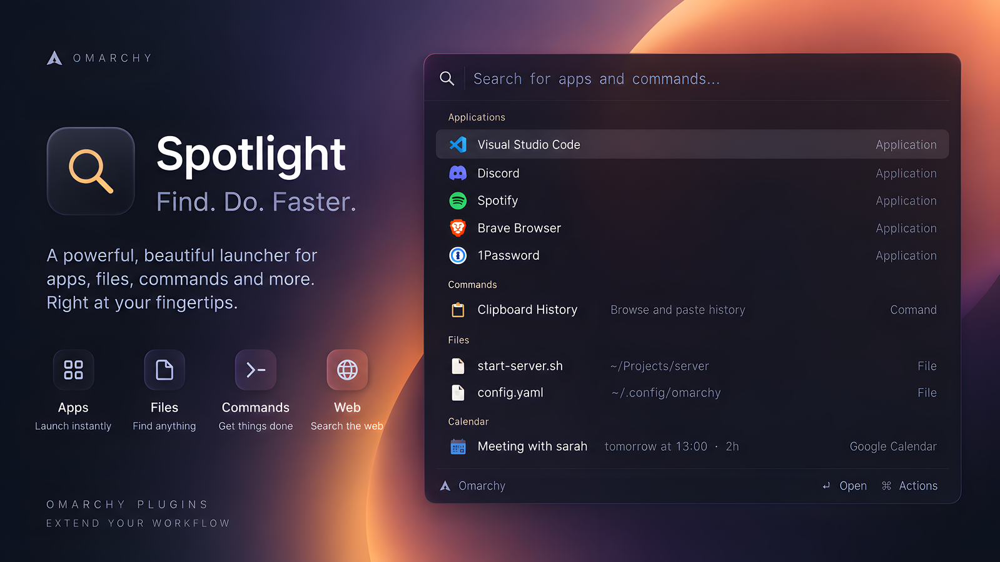

# Spotlight

**A fast, local-first command palette for Omarchy.**

Fork of [maajix/omarchy-spotlight](https://github.com/maajix/omarchy-spotlight) (MIT), renamed to
`eduardo.spotlight`. Differences from upstream:

- the preview pane also keeps the contents of `~/.kube`, `~/.docker`, `~/.aws`, `~/.codex`,
  `~/.config/gh`, `~/.config/gcloud`, `*.cnf` and `auth.json` off screen
- **Settings > Appearance** has Background opacity and Blur (card only) with a strength
- `help:` (or `?`) lists everything Spotlight can do, with examples
- **Settings > General > Last search**: reopening brings back your last search only within N seconds
  (default 5, or forever). Enter on a result or an AI answer forgets it right away, and an AI answer
  you haven't seen yet waits 10 minutes
- **Settings > Appearance > Compact start** opens a narrow bar that widens as results arrive, with a
  selectable motion style and animation time, and the empty box shows a random placeholder
- `gh:` lists your and your orgs' GitHub repos (`gh: api` keeps names containing "api") and `pr:`
  lists their open pull requests; both use the GitHub CLI you're already signed in to and show the
  last list instantly while refreshing

The website and documentation below are upstream's.

Launch apps, switch windows, find files, search your clipboard and control your desktop from one input. Calculate, convert currencies, create reminders, search the web or ask AI without leaving Spotlight.

[Website](https://maajix.github.io/omarchy-spotlight/) · [Documentation](https://maajix.github.io/omarchy-spotlight/docs/)



## Install

Requires **Omarchy 4 (Quattro)**. Core features use tools already included with Omarchy.

```bash
omarchy plugin add https://github.com/osszoi/omarchy-spotlight.git --enable
```

Press **Alt+Space** to open Spotlight. The first-run tour sets up the shortcut; if it is already taken, choose another. Search for `spotlight settings` to change sources, behavior or the shortcut later.

Settings are grouped into **General** (shortcut and data), **Search** (sources, results, web and currency), **Appearance**, and **AI** (provider and artifact settings, including weather location).

Under **Appearance**, **Vertical position** moves the launcher from 0% (top) to 100% (bottom); 50% keeps the default placement. **Horizontal position** moves it from 0% (left) to 100% (right); 50% keeps it centered. The vertical position reserves space for expanded results, so the search field stays fixed while you type. Screen margins keep the launcher visible, and small screens limit movement.

If the shortcut does not open Spotlight:

```bash
omarchy-shell shell toggle eduardo.spotlight '{}'
```

## Try it

| Type | What happens |
| --- | --- |
| `chrom` | Find apps, windows and matching local results |
| `f invoice` or `cb ssh` | Search files or clipboard history |
| `night light` | Show a live toggle and switch it in place |
| `12*7+3` or `100 USD to EUR` | Calculate or convert currencies |
| `remind me in 20m to check the oven` | Create a reminder |
| `ports:` or `ssh:` | Browse a system view |
| `gh quickshell` | Search GitHub |
| `ai: explain how DNS works` | Ask AI and see a visual answer |

Use **↑ / ↓** to select a result, **Enter** for its main action and **Shift+Enter** for its secondary action. **Esc** clears the query, then closes Spotlight.

A preview pane beside the list shows more about the selected result, such as other currencies, the start of a file or a live window thumbnail. Turn it off with **Preview pane** under **Appearance** in Spotlight Settings.

After moving to a folder result with **↑ / ↓**, press **→** to move the selection into its right-hand preview. The search results on the left stay in place. Use **↑ / ↓** to select entries and **←** to return one folder level, or back to the left-hand results. **Enter** opens the selected entry externally; **Tab** completes a folder name. Typing starts a new search, and **Esc** returns from browsing to the original search. The current folder path appears above the right-hand entries; listings are limited to 1,000 entries.

## Ask AI

Enable **Ask AI** in Spotlight Settings and choose an installed, signed-in **Claude or Codex CLI**. Submit questions with `ai:` and Enter. Answers can include copyable code and commands, maps, weather, charts, palettes, timelines and other visual cards. A running request keeps going when you close Spotlight; its answer comes back on reopen as described under Last search above.

AI and AI web search are opt-in. Generated commands are shown for you to review and copy. [AI setup and usage](https://maajix.github.io/omarchy-spotlight/docs/?p=ask-ai) · [All twelve artifact types](https://maajix.github.io/omarchy-spotlight/docs/?p=ai-artifacts)

## Documentation

The website holds the full reference:

- [Quickstart](https://maajix.github.io/omarchy-spotlight/docs/?p=quickstart), [search syntax](https://maajix.github.io/omarchy-spotlight/docs/?p=search-syntax) and [keyboard shortcuts](https://maajix.github.io/omarchy-spotlight/docs/?p=keyboard-shortcuts)
- [Settings](https://maajix.github.io/omarchy-spotlight/docs/?p=settings) and [settings reference](https://maajix.github.io/omarchy-spotlight/docs/?p=settings-reference)
- [Update and remove](https://maajix.github.io/omarchy-spotlight/docs/?p=installation#update), [troubleshooting](https://maajix.github.io/omarchy-spotlight/docs/?p=troubleshooting) and [changelog](https://maajix.github.io/omarchy-spotlight/docs/?p=changelog)
- [Development and artifact contributions](https://maajix.github.io/omarchy-spotlight/docs/?p=development)

Spotlight runs inside `omarchy-shell` with no separate launcher process. Ordinary search and ranking stay local; the plugin has no telemetry or analytics. [Privacy and security](https://maajix.github.io/omarchy-spotlight/docs/?p=privacy-security) explains network access and local storage. Report vulnerabilities privately as described in [SECURITY.md](SECURITY.md).

MIT, see [LICENSE](LICENSE). Spotlight is not affiliated with Apple or Raycast.
